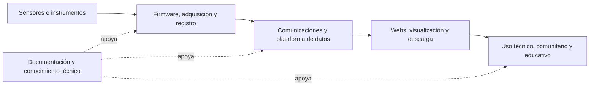

# Visión general del trabajo

Revisión preliminar: 2026-11-11. Esta síntesis responde al objetivo de mirar el portafolio completo para proponer publicaciones. Se basa en el inventario inicial, diez README representativos revisados por agentes gpt-6.1-sol y dos fichas locales. La cobertura no equivale a una auditoría de todos los repositorios ni a evaluación de novedad científica.

## Hilo conductor

La lectura conjunta sugiere un trabajo de **integración de sistemas para observar el ambiente y hacer utilizables sus datos**: adquisición con sensores y firmware, almacenamiento y comunicaciones, servicios de datos, webs públicas y documentación para operación y reutilización. Es una interpretación del portafolio, no una declaración de que todos esos componentes formen ya un sistema único validado.

La amplitud importa: los proyectos pueden aportar casos distintos para estudiar problemas comunes —trazabilidad, pérdida de datos, mantenimiento, calibración, reutilización y comprensión pública—. Contar repositorios no mide contribución científica. Primero hay que reconstruir qué problemas resolviste, cómo los resolviste y qué evidencia quedó de esas soluciones.

El diagrama es un mapa conceptual de líneas de trabajo. No acredita enlaces operativos entre cada repositorio.

## Familias del portafolio personal

P01 agrupó una vez cada una de las 100 entradas disponibles de AleReb. La mayoría se clasificó por nombre; cinco README añadieron evidencia de contenido. Los 100 registros no incluyen todo el trabajo conocido: modularAirFlow y voluntariosxagua locales se revisaron aparte. [Mapa completo y fuentes](resultados/P01/panorama.md).

| Familia | Entradas del inventario | Qué conviene rescatar para investigación |
| --- | ---: | --- |
| Calidad del aire, HIRI y estaciones | 18 | Campañas, calibración, co-ubicación, continuidad y configuraciones reales |
| Suelo, agua y territorio | 13 | Variables, estaciones, comunicaciones, contexto territorial y datos originales |
| Biodigestión y procesos | 3 | Instrumentación multiparamétrica y registros de operación |
| Adquisición, PCB, comunicaciones y almacenamiento | 25 | Diseño reutilizable, cambios de plataforma, recuperación ante fallos y trazabilidad |
| Imagen, visión y robótica | 9 | Aplicaciones reales y evaluación; todavía clasificación por nombre |
| Conocimiento y documentación técnica | 8 | Recursos compartidos, documentación operativa y recuperación con fuentes |
| Docencia, interfaces y experimentación | 16 | Prácticas reutilizables; resultados educativos solo si se documentan |
| Propósito por confirmar | 8 | Leer antes de descartar o asignar una contribución |

## Plataformas y webs: una segunda capa del trabajo

La revisión de cinco README de cmasudd permite distinguir recorridos de datos diferentes. Los ocho repos restantes tienen clasificación provisional. [Panorama web y fuentes](resultados/P02/panorama.md).

| Proyecto | Recorrido descrito en documentación | Pregunta transversal que abre |
| --- | --- | --- |
| SensorsWebApp | Portal asociado a sensores.cmasccp.cl; el README declara cmasudd como repositorio canónico | Cómo relacionar dispositivo, dato y operación del servicio |
| Aire Aconcagua | MariaDB → CSV mensuales; consulta reciente separada; uso comunitario y modo Escolar | Cómo publicar históricos y datos recientes sin perder procedencia |
| Aire Aysén | Fuente Looker → promedios horarios → CSV y portal | Cómo conservar significado y calidad al integrar fuentes heterogéneas |
| CalidadAgua | CSV/manifiesto/histórico y consulta reciente; nivel declarado preliminar | Cómo comunicar límites de comparabilidad de las mediciones |
| Voluntarios por el Agua | Jornadas y registros ciudadanos; planilla/fotos → JSON/CSV y web | Cómo preservar trazabilidad, localización e incertidumbre en datos ciudadanos |

Estas arquitecturas son declaraciones documentales; no se inspeccionó el servidor interno ni se reprodujeron los publicadores. La administración de sensores.cmasccp.cl y la creación de las webs fueron declaradas por el usuario. Los roles del resto del equipo, la procedencia de datos y la autoría específica deben acompañar cualquier publicación.

## Evidencia prometedora y brechas

**Aire:** estacion-calidad-aire enlaza informes de laboratorio y co-ubicación SINCA. Es una pista concreta de evidencia experimental existente: leer esos documentos puede cambiar mucho la prioridad editorial. El README asigna a Alejandro firmware y comunicaciones y describe un equipo colectivo; no implica que toda la estación sea una contribución individual. [P01-E02](resultados/P01/evidencias.json).

**Datos ciudadanos:** en T02 se inspeccionó un derivado JSON local con siete estaciones, nueve parámetros y 394 registros. Es evidencia de un recurso disponible para revisar, no un dataset ya validado; faltan correspondencia con planilla, unidades, repetidos, ubicación y permisos. [Ficha y revisión T02](resultados/T02/revision.md).

**Hardware:** modularAirFlow contiene referencias funcionales declaradas y propuestas nuevas separadas; coexisten protocolos incompatibles y no hay validación de todas las variantes. La biblioteca de hardware declara aportes colectivos y recopilación de Alejandro. Esto favorece preparar primero una historia técnica y un paquete reproducible de un dispositivo elegido. [T01](resultados/T01/ficha.md), [P01-E06](resultados/P01/evidencias.json).

**Conocimiento:** cmas-mcp describe un corpus procesado de 193 videos, pendiente de verificar. Puede estudiarse la recuperación de conocimiento técnico, pero hacen falta preguntas, respuestas de referencia y evaluación. BioDiges, por su parte, documenta un registrador multiparamétrico; la existencia de firmware no demuestra beneficios al proceso biológico. [P01-E03/E05](resultados/P01/evidencias.json).

## Qué representa esta visión

El portafolio ofrece una base plausible para publicaciones de sistemas y software, instrumentación, datos y casos de uso. Los artículos científicos con resultados requerirán preguntas y comparaciones específicas. Las notas técnicas, guías de operación y paquetes documentales también pueden comunicar aportes reales, sin convertir cada proyecto en un paper.

La siguiente decisión es elegir qué líneas tienen mejor evidencia recuperable. Las propuestas y el orden inicial están en [PROPUESTAS_PUBLICACIONES.md](PROPUESTAS_PUBLICACIONES.md). LinkedIn servirá para completar cronología y roles, y el servidor para confirmar arquitecturas; ninguno debe bloquear la formulación preliminar de las líneas.

## Actualización de viabilidad — 2026-11-12

Se leyeron dos informes completos de aire y seis archivos de exportadores/pruebas/configuración, se reconciliaron historias Git de agua y se contrastaron tres registros locales con la planilla. El panorama mantiene su amplitud, pero la ruta inicial se concreta en A (contratos/trazabilidad), con C alternativa y B pendiente de fuentes originales. Ver [VIABILIDAD_PUBLICACIONES.md](VIABILIDAD_PUBLICACIONES.md).
